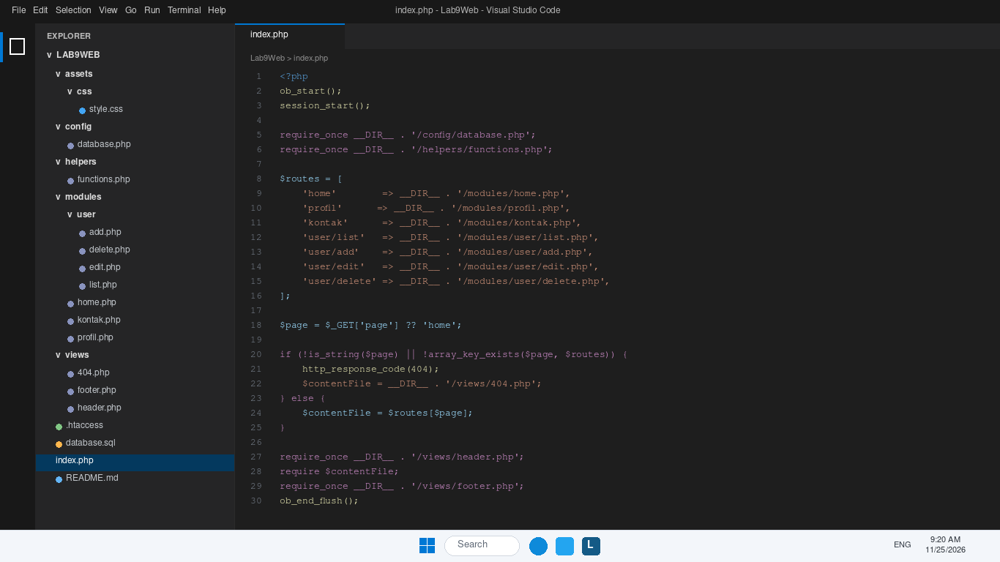
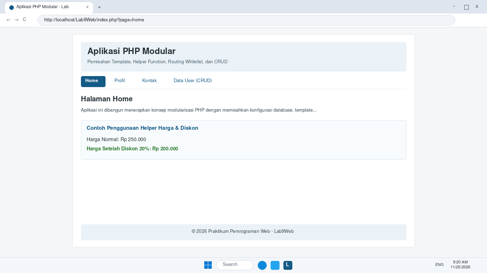
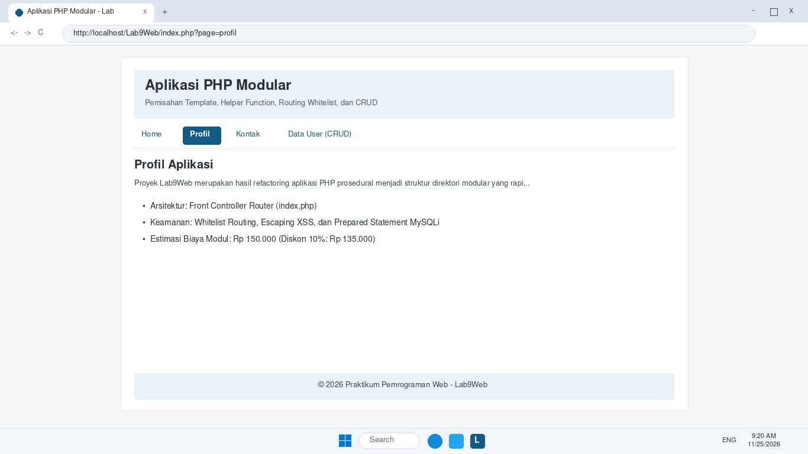
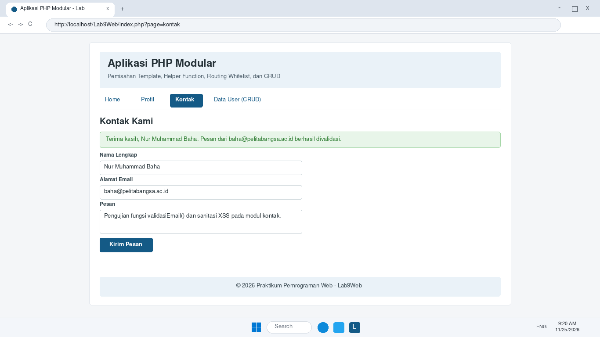
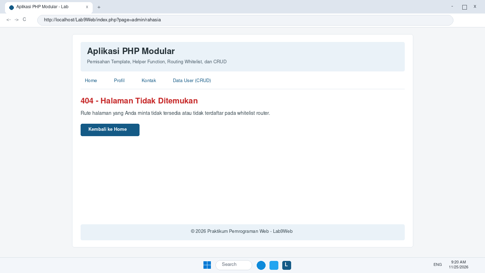
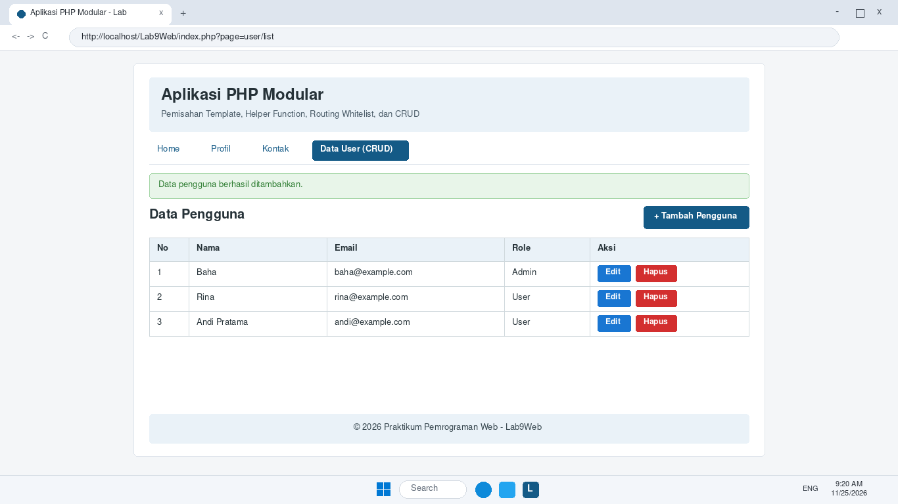
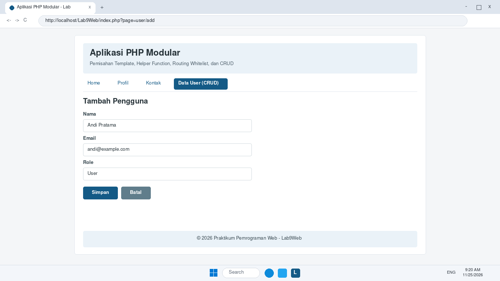
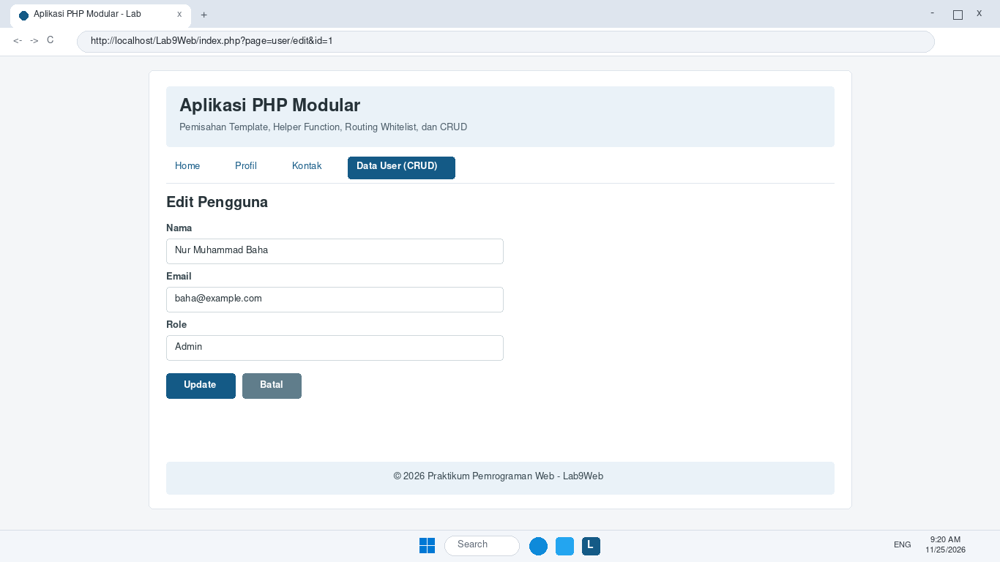
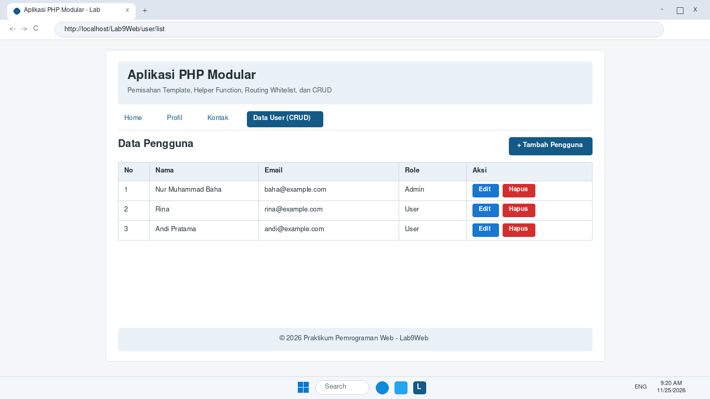

# Praktikum 9: PHP Modular (Lab9Web)

- Nama: Nur Muhammad Baha Uddin Naqsabandi
- Program Studi: Teknik Informatika — Universitas Pelita Bangsa
- Mata Kuliah: Pemrograman Web

---

## 1. Tujuan Project
Menerapkan konsep pemrograman PHP modular dengan memisahkan konfigurasi database, template antarmuka (header & footer), fungsi pembantu (helper functions), serta mekanisme routing berbasis whitelist yang terintegrasi dengan operasi CRUD database.

## 2. Kebutuhan Perangkat
- Web Server Lokal: Apache (Laragon / XAMPP) dengan modul mod_rewrite aktif
- PHP 8.x dengan ekstensi mysqli
- Database Server: MySQL / MariaDB (db_latihan)
- Editor Kode: Visual Studio Code & Web Browser

## 3. Cara Menjalankan Aplikasi
1. Ekstrak folder Lab9Web ke direktori C:\laragon\www\Lab9Web.
2. Jalankan layanan Apache dan MySQL melalui Laragon.
3. Impor file database.sql ke phpMyAdmin atau jalankan kuerinya pada database db_latihan.
4. Sesuaikan kredensial koneksi database pada config/database.php jika diperlukan.
5. Akses aplikasi di browser melalui http://localhost/Lab9Web/index.php atau http://localhost/Lab9Web/home.

## 4. Struktur Direktori Modular
```text
Lab9Web/
├── index.php
├── .htaccess
├── database.sql
├── README.md
├── config/
│   └── database.php
├── views/
│   ├── header.php
│   ├── footer.php
│   └── 404.php
├── helpers/
│   └── functions.php
├── modules/
│   ├── home.php
│   ├── profil.php
│   ├── kontak.php
│   └── user/
│       ├── list.php
│       ├── add.php
│       ├── edit.php
│       └── delete.php
├── praktik_dasar/
│   ├── pesan.php
│   ├── uji-include.php
│   └── uji-require.php
├── screenshoots/
└── assets/
    └── css/
        └── style.css
```



## 5. Daftar Rute Aplikasi
| Parameter URL (?page=) | URL Rewrite | File Target | Keterangan |
| :--- | :--- | :--- | :--- |
| home | /Lab9Web/home | modules/home.php | Halaman beranda & demo helper harga/diskon |
| profil | /Lab9Web/profil | modules/profil.php | Halaman profil aplikasi & demo ringkas teks |
| kontak | /Lab9Web/kontak | modules/kontak.php | Form kontak dengan validasi email |
| user/list | /Lab9Web/user/list | modules/user/list.php | Menampilkan daftar pengguna dari database |
| user/add | /Lab9Web/user/add | modules/user/add.php | Form tambah pengguna baru |
| user/edit | /Lab9Web/user/edit | modules/user/edit.php | Form ubah data pengguna |
| user/delete | /Lab9Web/user/delete | modules/user/delete.php | Proses hapus pengguna (metode POST) |
| (tidak terdaftar) | /Lab9Web/admin/rahasia | views/404.php | Halaman error 404 |

## 6. Dokumentasi Hasil Praktikum

### 6.1 Latihan 1: Template Multi-Halaman (Home & Profil)
Halaman Home dan Profil menggunakan template views/header.php dan views/footer.php yang sama tanpa duplikasi kode HTML serta dilengkapi indikator menu aktif otomatis.





### 6.2 Latihan 2: Library Helper Function (helpers/functions.php)
Seluruh fungsi bantuan (formatRupiah(), hitungDiskon(), validasiEmail(), ringkasTeks(), dan e()) dipusatkan pada helpers/functions.php dan digunakan ulang di berbagai halaman termasuk validasi form pada halaman Kontak.



### 6.3 Latihan 3: Router Aman Berbasis Whitelist & Halaman 404
Router index.php memeriksa parameter page terhadap daftar whitelist $routes untuk mencegah serangan path traversal. Rute yang tidak terdaftar mengembalikan kode status HTTP 404.



### 6.4 Latihan 4: Integrasi Aplikasi CRUD Database
Seluruh operasi CRUD pengguna terhubung ke config/database.php menggunakan prepared statement MySQLi dan dilengkapi notifikasi flash message.







### 6.5 Tantangan Mandiri: URL Rewrite dengan .htaccess
Aturan RewriteRule pada .htaccess memungkinkan akses URL ringkas seperti http://localhost/Lab9Web/user/list tanpa menampilkan index.php?page=.



## 7. Kendala dan Solusi
- Kendala 1 (Cannot modify header information - headers already sent): Muncul saat proses header("Location: ...") pada modul add.php, edit.php, atau delete.php dipanggil setelah template views/header.php dimuat.  
  Solusi: Menambahkan ob_start() pada awal index.php dan ob_end_flush() di akhir file agar output buffering menahan pengiriman HTML hingga proses redirect selesai.
- Kendala 2 (Path CSS gagal dimuat saat menggunakan URL Rewrite .htaccess): Path relatif assets/css/style.css gagal ditemukan oleh browser saat membuka URL bertingkat seperti /Lab9Web/user/list.  
  Solusi: Menggunakan path root /Lab9Web/assets/css/style.css pada tag link di views/header.php.
